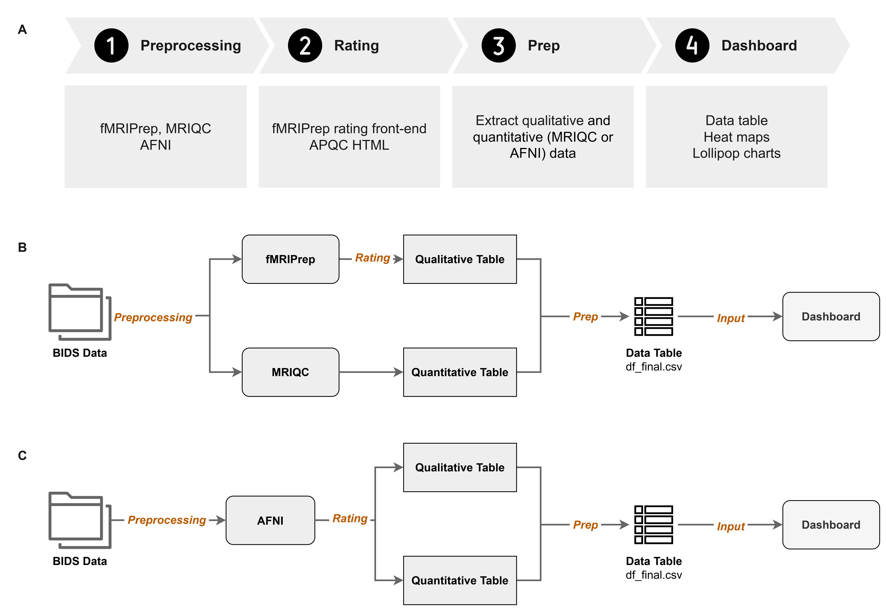
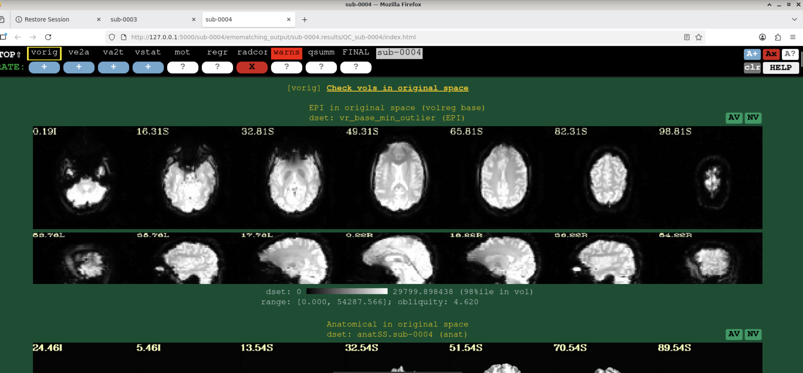
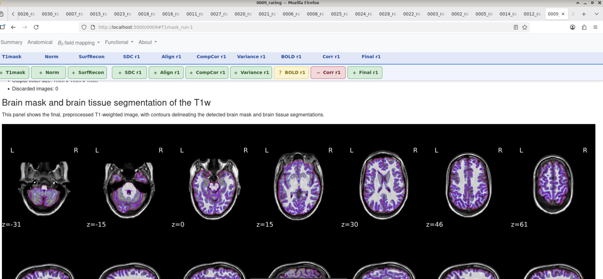
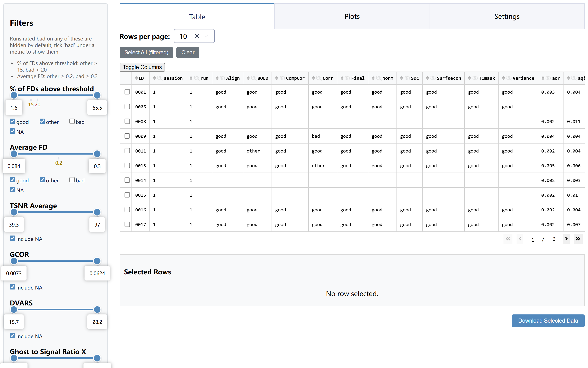
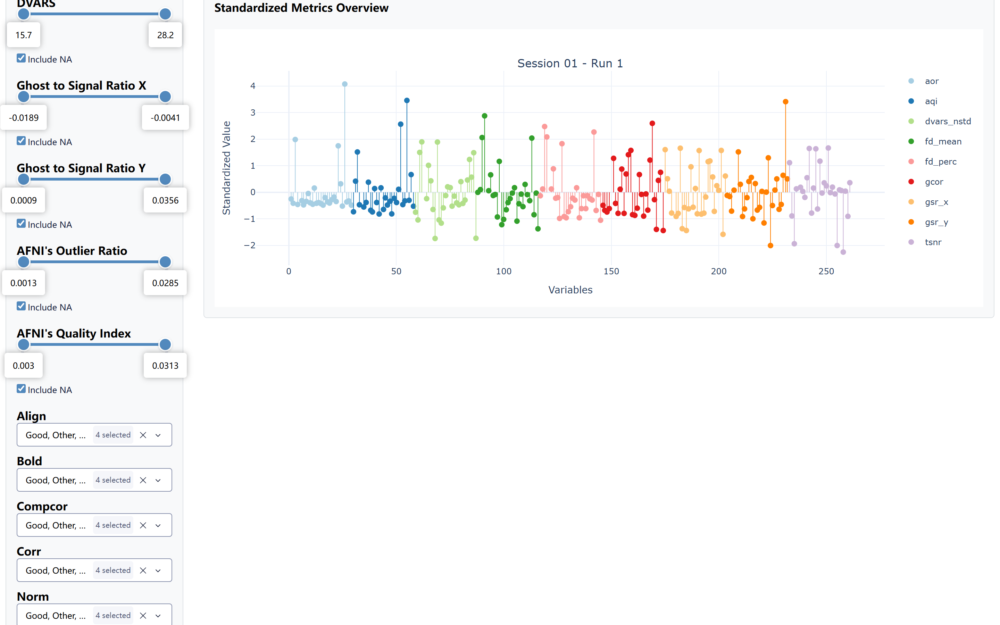
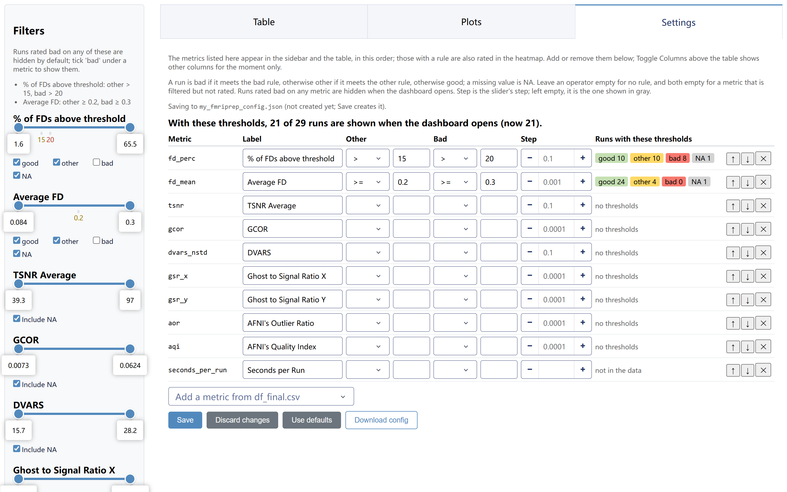

# fMRI-QCtoolkit

fMRI-QCtoolkit is a Python package for the quality control (QC) of preprocessed fMRI data. It combines your visual ratings of each participant's QC report with the quantitative metrics from [AFNI](https://afni.nimh.nih.gov/) or [MRIQC](https://mriqc.readthedocs.io/en/latest/), and shows both in an interactive dashboard where you filter runs, look at them in a table and in plots, and download the ones you keep. It works with the outputs of [fMRIPrep](https://fmriprep.org/en/stable/) and AFNI's `afni_proc.py`.

**Handbook: <https://qiuyuyu3.github.io/fMRI-QCtoolkit/>**



## Install

Python 3.11 or newer is required. Create or activate a virtual environment, then install from PyPI:

```bash
pip install fmri-qctoolkit
```

## Quick start

### 1. Rate

Rate AFNI output in AFNI's APQC report:

```bash
fmriqc rating afni \
    --input-dir /PATH/AFNI_derivatives \
    --subjects "001,002" \
    --task rest \
    --prefix sub-
```



Rate fMRIPrep output in the toolkit's rating page, on top of the fMRIPrep report:

```bash
fmriqc rating fmriprep \
    --input-dir /PATH/fmriprep \
    --subjects "001,002" \
    --output-dir /PATH/ratings
```



### 2. Prepare

Collect the ratings and the metrics into one table, `df_final.csv`. For fMRIPrep, the metrics come from MRIQC's `group_bold.tsv`.

```bash
fmriqc prep afni \
    --input-dir /PATH/AFNI_derivatives \
    --task rest \
    --prefix sub- \
    --output-dir /PATH/QC
```

```bash
fmriqc prep fmriprep \
    --bold-file /PATH/mriqc/group_bold.tsv \
    --rating-dir /PATH/ratings \
    --task rest \
    --output-dir /PATH/QC
```

### 3. View

```bash
fmriqc dashboard fmriprep \
    --data-file /PATH/QC/df_final.csv \
    --task rest
```

For AFNI, use `fmriqc dashboard afni` with the same options. Open the link printed in the terminal. Runs rated bad on any metric are hidden at first; the filters on the left change which runs are shown.

The **Table** tab lists the runs. Select some and download them.



The **Plots** tab shows the ratings as heatmaps and the metrics as a lollipop chart.




The **Settings** tab chooses the metrics shown and the thresholds that rate them.



The screenshots show simulated data.

## On an HPC cluster

Start a remote desktop session on the cluster (such as XDesktop or an Open OnDemand desktop), open a terminal in it, and load Firefox before running the commands above:

```bash
ml Firefox
```

The rating pages open in Firefox. For the dashboard, copy the printed link into Firefox. Module names differ between clusters; `module avail firefox` lists yours. To rate AFNI output, load AFNI as well. More in [Opening the pages](https://qiuyuyu3.github.io/fMRI-QCtoolkit/opening-pages.html).

## Documentation

- [Handbook](https://qiuyuyu3.github.io/fMRI-QCtoolkit/)
- [Training materials](https://github.com/QiuyuYu3/fMRI-QCtoolkit/tree/main/training_materials)
- [Change log](https://github.com/QiuyuYu3/fMRI-QCtoolkit/blob/main/CHANGELOG.md)

## Citation

A paper describing fMRI-QCtoolkit is in preparation. Until then, cite the software with the details in [CITATION.cff](https://github.com/QiuyuYu3/fMRI-QCtoolkit/blob/main/CITATION.cff) ("Cite this repository" on GitHub). Please also cite the tools whose outputs you rate:

- Cox, R. W. (1996). AFNI: software for analysis and visualization of functional magnetic resonance neuroimages. Computers and Biomedical Research, 29(3), 162–173. https://doi.org/10.1006/cbmr.1996.0014
- Esteban, O., Birman, D., Schaer, M., Koyejo, O. O., Poldrack, R. A., & Gorgolewski, K. J. (2017). MRIQC: Advancing the automatic prediction of image quality in MRI from unseen sites. PLoS ONE, 12(9), e0184661. https://doi.org/10.1371/journal.pone.0184661
- Esteban, O., Ciric, R., Finc, K., et al. (2020). Analysis of task-based functional MRI data preprocessed with fMRIPrep. Nature Protocols, 15, 2186–2202. https://doi.org/10.1038/s41596-020-0327-3

The default AFNI thresholds follow Reynolds, R. C., Taylor, P. A., & Glen, D. R. (2023). Quality control practices in FMRI analysis: Philosophy, methods and examples using AFNI. Frontiers in Neuroscience, 16, 1073800. https://doi.org/10.3389/fnins.2022.1073800

The full list of references is in the [handbook](https://qiuyuyu3.github.io/fMRI-QCtoolkit/citation.html).

## License

[Apache License 2.0](https://github.com/QiuyuYu3/fMRI-QCtoolkit/blob/main/LICENSE)
