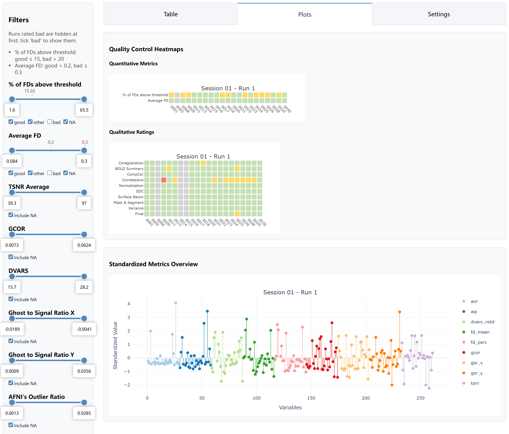

# fMRI-QCtoolkit

fMRI-QCtoolkit is a modular Python package for fMRI (functional Magnetic Resonance Imaging) quality control (QC), integrating quantitative metrics from [MRIQC](https://mriqc.readthedocs.io/en/latest/), [fMRIPrep](https://fmriprep.org/en/stable/), and [AFNI](https://afni.nimh.nih.gov/), along with manual scoring. The package includes an interactive dashboard with customizable filters and visualizations, a lightweight front-end for manual rating for fMRIPrep, and supports batch-level scoring for both fMRIPrep and AFNI outputs.


## Install
Python 3.11 or newer is required. Create or activate a virtual environment, then install from PyPI:

```bash
pip install fmri-qctoolkit
```

The example data used in the commands below is not part of the PyPI package. To run the examples, or to work on the code, clone the repository and install it in development mode:

```bash
git clone https://github.com/QiuyuYu3/fMRI-QCtoolkit.git
cd fMRI-QCtoolkit
pip install -e .[dev]
```

# Usage

## STEP1: Rating

After the completion of preprocessing, perform qualitative scoring on the derivatives.

### AFNI
AFNI provides [scripts](https://afni.nimh.nih.gov/pub/dist/doc/htmldoc/tutorials/apqc_html/browsing.html#using-a-script-to-load-many-apqc-html-files) for browsing multiple subjects' QC files. However, using `firefox` on HPC (High-performance computing) systems may result in issues interacting with buttons, so this using `open_apqc.py` is another option (while ensuring the required Python packages are activated in the environment).

The directory structure of AFNI derivatives is as follows:
```
.
└── AFNI_derivatives/
    ├── sub-001/
    │   └── ses-01/
    │       └── cards_output/
    │           └── sub-001.results/
    │               ├── QC_sub-001
    │               └── ...
    ├── sub-002
    ├── sub-003
    └── ...
```

**Input Arguments:**
- `fmriqc rating afni`: Indicate which rating program.
- `--input-dir`: Root directory, containing results that preprocessed from different participants.
- `--subjects`: Support input multiple participants IDs.
- `--task`: Rating program will search `task` in `input-dir` to find the `QC_{subj}`
- `--prefix`: The prefix of participants IDs. 

**Example Synatx:**
```bash
fmriqc rating afni --input-dir /PATH/AFNI_derivatives --subjects "003,009" --task ses-01/cards --prefix sub-
```

*Although I've tried to make the scoring criteria flexible, it may still not support all pathfinding scenarios. Therefore, you can also try [script version](https://github.com/QiuyuYu3/fMRI-QCtoolkit/blob/main/examples/scripts/rating/afni_rating.sh).*

> [!IMPORTANT]  
> The rating program relies on the `open_apqc.py` tool developed by AFNI.  
> You can either:
> - Make sure `open_apqc.py` is on your `$PATH` (e.g., load the AFNI module first), or  
> - Provide a custom path using the `--afni-path` option when running the command.
> `fmriqc rating afni --input-dir /PATH/AFNI_derivatives --subjects "003,009" --task ses-01/cards --prefix sub- --afni-path /PATH`


### fMRIPrep
The rating module in **fMRI-QCtoolkit** is based on the HTML reports generated by fMRIPrep (e.g., `sub-{ID}.html`).  
Each QC item maps directly to specific sections of the original [fMRIPrep report](https://fmriprep.org/en/stable/_static/SampleReport/sample_report.html).

- Brain mask and brain tissue segmentation of the T1w (T1mask)
- Spatial normalization of the anatomical T1w reference (Norm)
- Surface reconstruction (SurfRecon)
- Susceptibility distortion correction (SDC)
- Alignment of functional and anatomical MRI data (coregistration) (Align)
- Brain mask and (anatomical/temporal) CompCor ROIs (CompCor)
- Variance explained by t/aCompCor components (Variance)
- BOLD Summary (BOLD)
- Correlations among nuisance regressors (Corr)

The interface is divided into two parts:  
- **Upper panel**: navigate modules with a left-click; scroll horizontally with the mouse wheel.  
- **Lower panel**: interactive rating area, similar to [AFNI’s APQC HTML](https://afni.nimh.nih.gov/pub/dist/doc/htmldoc/tutorials/apqc_html/main_toc.html).  
  - Left-click to rate, Ctrl+click to add comments.  
  - Rating buttons toggle between: good (+, green), bad (×, red), and other (?, yellow).  
  - Results are saved automatically as CSV files (subject-level and task-level). Upon reopening the program with the same code, it will automatically retrieve the previous scores by extracting the subject-level CSV file.

> [!IMPORTANT]
> If the program cannot detect the session and run number, both will default to 1. For example, the saved CSV file name would be `sub-{ID}_ses-01_rest.csv`. Therefore, when merging with files generated by MRIQC, you need to modify the `ses` parameters.

> [!IMPORTANT]
> For multi-session subjects, fMRIPrep merges all T1w images into a single anatomical reference ([longitudinal processing](https://fmriprep.org/en/stable/workflows.html#longitudinal-processing)). T1mask / Norm / SurfRecon therefore describe that merged image: one rating per subject, not per session. If several images appear under one of these headings, the subject was processed more than once; check the `Get figure file:` line and rate the one from your current run.

The directory structure of fMRIPrep derivatives is as follows:
```
.
└── fMRIPrep_derivatives/
    ├── sub-001
    ├── sub-001.html
    ├── sub-002
    ├── sub-002.html
    ├── sub-003
    ├── sub-003.html
    ├── dataset_description.json
    ├── desc-aparcaseg_dseg.tsv
    ├── desc-aseg_dseg.tsv
    └── ...
```

**Input Arguments:**
- `fmriqc rating fmriprep`: Indicate which rating program.
- `--input-dir`: Root directory, containing results that preprocessed from different participants.
- `--subjects`: Support input multiple participants IDs.
- `--output-dir`: Path for exporting the scoring CSV file.
- `--no-browser`: Only print the links, without opening browser tabs (useful on HPC; see [Opening the Pages](#opening-the-pages)).

**Example Synatx:**
```bash
fmriqc rating fmriprep --input-dir /PATH/fMRIPrep_derivatives --output-dir /PATH/Output_dir --subjects "1013,1026"
```


## STEP2: Data Preparation
By extracting information from qualitative rating files, `fmriqc prep` then writes `df_final.csv`, the table the dashboard reads.

### AFNI
After finishing preprocessing and rating, both quantitative and qualitative rating information are saved in `QC_{subj}/extra_info/out.ss_review.{subj}.json`. `df_final.csv` keeps every numeric field of this file (a field that holds a list, such as per-run values, gets one column per value), so any of them can be added to the dashboard later.

**Input Arguments:**
- `fmriqc prep afni`: Indicate which rating program.
- `--input-dir`: Root directory, containing results that preprocessed from different participants.
- `--output-dir`: Path for exporting `df_final.csv`.
- `--task`: Prep program will search `task` in `input-dir` to find the `QC_{subj}/extra_info/out.ss_review.{subj}.json` across all participants. Each run covers one session: if a subject matches in more than one place (for example `ses-01/rest_output` and `ses-02/rest_output`), narrow `--task` to `ses-01/rest`.
- `--prefix`: The prefix of participants IDs.

**Example Synatx:**
```bash
fmriqc prep afni --input-dir /PATH/AFNI_derivatives --task ses-01/kidvid --output-dir /PATH/Output_dir --prefix sub-
```

> [!NOTE]
> The dashboard rates the quantitative parameters with the thresholds of Reynolds et al. (2023) ([table](https://www.frontiersin.org/files/Articles/1073800/fnins-16-1073800-HTML/image_m/fnins-16-1073800-t001.jpg)). To use your own, see [Thresholds and filters](#thresholds-and-filters).

### fMRIPrep

After finishing rating procedure, merge the qualitative rating files with quantitative file (`group_bold.tsv`) that generates by MRIQC, and write `df_final.csv` for the dashboard. `df_final.csv` keeps every numeric metric of `group_bold.tsv`, so any of them can be added to the dashboard later.

**Input Arguments:**
- `fmriqc prep fmriprep`: Indicate which rating program.
- `--bold-file`:  Input `group_bold.tsv` file that generated by MRIQC.
- `--rating-dir`: Path for storing fMRIPrep qualitative scores.
- `--task`: Indicate which task's rating data you want to use.
- `--output-dir`: Path for exporting `df_final.csv`.

**Example Synatx:**
```bash
fmriqc prep fmriprep --bold-file examples/example_data/fmriprep/group_bold.tsv --rating-dir examples/example_data/fmriprep/ --task rest --output-dir examples/example_data/fmriprep/
```

> [!NOTE]
> The quantitative parameters are MRIQC's [image quality metrics](https://mriqc.readthedocs.io/en/latest/iqms/bold.html). By default the dashboard rates `fd_perc` and `fd_mean` only, with cut-offs adapted from the AFNI ones, and shows a few other metrics that can be filtered but are not rated. To change this or add other metrics, see [Thresholds and filters](#thresholds-and-filters).

### STEP3: Viewing and Filtering Results via Dashboard
Visualize, filter, and export selected data.

The left side of the dashboard features filter sidebars where users can select the desired ranges. The central tabs display the data table, the visualizations (heatmaps and lollipop charts), and the settings (see [Thresholds and filters](#thresholds-and-filters)). The table shows the ID, session and run columns, the metrics in the sidebar and the ratings; **Toggle Columns** above it shows the other columns of `df_final.csv` until the page is reloaded. To show a metric for good, add it in the Settings tab. After selecting rows in the data table, the blue download button below allows exporting the corresponding data frame with all its columns.

By default, runs rated bad on any metric are hidden, while runs rated other stay visible and show yellow in the heatmap. Under each rated metric, tick boxes choose which ratings (good, other, bad, NA) are shown; tick bad to bring those runs back. The sliders start at the full range and narrow the view further.





### AFNI

**Input Arguments:**
- `fmriqc dashboard afni`: Indicate which rating program.
- `--data-file`: Input the merged dataframe (`df_final.csv`).
- `--task`: Specify the task name to be used when downloading data.
- `--config`: Optional. The file that holds your settings; the Settings tab saves to it and creates it if it does not exist. See [Thresholds and filters](#thresholds-and-filters).

**Example Synatx:**
```bash
fmriqc dashboard afni --data-file /PATH/Output_dir/df_final.csv --task kidvid
```

### fMRIPrep

**Input Arguments:**
- `fmriqc dashboard fmriprep`: Indicate which rating program.
- `--data-file`: Input the merged dataframe (`df_final.csv`).
- `--task`: Specify the task name to be used when downloading data and filtering task in the merged dataframe.
- `--config`: Optional. The file that holds your settings; the Settings tab saves to it and creates it if it does not exist. See [Thresholds and filters](#thresholds-and-filters).

**Example Synatx:**
```bash
fmriqc dashboard fmriprep --data-file examples/example_data/fmriprep/df_final.csv --task rest
```

### Thresholds and filters
Each dashboard reads a config file that lists the metrics in the sidebar and the thresholds that rate them. The ratings color the quantitative heatmap and set the default filters. The package ships a default for each pipeline ([AFNI](https://github.com/QiuyuYu3/fMRI-QCtoolkit/blob/main/fMRI_QCtoolkit/dashboard/afni_config.json), [fMRIPrep](https://github.com/QiuyuYu3/fMRI-QCtoolkit/blob/main/fMRI_QCtoolkit/dashboard/fmriprep_config.json)).

To use your own thresholds, start the dashboard with `--config` and a file name, then change them in the **Settings** tab:

```bash
fmriqc dashboard fmriprep --data-file examples/example_data/fmriprep/df_final.csv --task rest --config my_fmriprep_config.json
```

- If the file does not exist yet, the dashboard starts from the default and creates the file when you first save. Pass the same `--config` next time to keep your thresholds.
- Each row of the tab is one metric: its label, the `other` and `bad` rules (an operator and a number), and the slider step. Beside each row, the tab counts the runs that the thresholds in the form rate good, other, bad and NA, and above the rows it says how many runs would be shown when the dashboard opens.
- The rows are the metrics the dashboard shows, in the sidebar and the table, in this order; those with a rule are also rated in the heatmap. The list under the rows adds a metric (it offers the numeric columns of `df_final.csv` not in the form yet), ✕ removes one, and the arrows change the order.
- **Save** checks the thresholds, writes the file, and reloads the page with them. The file it replaces is kept beside it as `<name>.bak`. **Discard changes** goes back to the saved thresholds, and **Use defaults** fills in the package's defaults without saving them.
- **Download config** saves the settings in the form as a file on the computer running the browser, for example to start with next time, to share, or to keep with a study. It works without `--config` too: the tab then cannot save, so download the file and pass it with `--config` next time.


The config is a JSON file that can also be edited by hand. `fmriqc config` writes a copy of the default to start from, and a file edited by hand takes effect when the dashboard is started again:

```bash
fmriqc config fmriprep --output my_fmriprep_config.json
```

`fmriqc config` does not overwrite an existing file unless you add `--force`, so edited thresholds are not replaced by the defaults by accident. When the dashboard starts, it prints the path of the config it uses.

Each metric is one entry, keyed by its column in `df_final.csv`:

```json
{
  "metrics": {
    "cens_frac":       {"label": "Censor Fraction",         "other": ">= 0.15", "bad": ">= 0.2"},
    "TSNR":            {"label": "TSNR Average",            "other": "<= 150"},
    "flip_guess":      {"label": "Flip Guess",                                  "bad": "!= 0",   "step": 1},
    "frac_TRs_cens_*": {"label": "Fraction TRs Censored",                       "bad": ">= 0.2"},
    "gsr_x":           {"label": "Ghost to Signal Ratio X"}
  }
}
```

- `label`: The name shown in the sidebar and the heatmap. Defaults to the column name.
- `bad` and `other`: An operator (`>`, `>=`, `<`, `<=`, `==`, `!=`) followed by a number. A run is bad if it meets the `bad` rule, otherwise other if it meets the `other` rule, otherwise good; a missing value is NA. Give only `other` for a metric without a bad level, and neither for a metric that is filtered but not rated (it is left out of the heatmap).
- `step`: Optional. The slider step; by default it follows the range of the data.
- A key with `*` covers every matching column, so `frac_TRs_cens_*` gives one entry per stimulus class, each labeled with its column name. The Settings tab can change or remove such an entry; a new one is added by editing the file.
- Metrics appear in the sidebar and the heatmap in the order of the file. Metrics that are not in the data are skipped, and the dashboard lists them when it starts.
- The file replaces the default as a whole: metrics you leave out are not shown.
- Config files from version 1.x no longer work; write a new one with `fmriqc config`.

# Opening the Pages
`fmriqc rating fmriprep` and `fmriqc dashboard` print a link in the terminal, for example:

```
http://localhost:5003/0030?token=Xk3v9QpL2mR7tYwZ8aBcD1eF4gH6jK0n
```

Open that link in your browser; on your own computer the rating pages open by themselves. Every start prints a new link, so if a page says "Access denied", use the link printed most recently.

**On HPC.** Add `--no-browser` to `fmriqc rating fmriprep`. Then, on your own computer, open a terminal and forward the port number in the link (5003 here):

```bash
ssh -N -L 5003:127.0.0.1:5003 user@hpc.example.edu
```

Leave that terminal open and open the printed link in your browser. If the server runs on a compute node (for example `node123` in an `srun` or `salloc` session), go through the login node instead:

```bash
ssh -N -L 5003:127.0.0.1:5003 -J user@hpc.example.edu user@node123
```

**Advanced.** The token in the link keeps other users on the same machine out of the pages; after the first visit it is kept in a browser cookie. If you forward to a different local port (`-L 8888:127.0.0.1:5003`), change the port in the link and keep the token. `fmriqc dashboard --host` can bind to an address that other machines can reach, in which case the token is the only protection; with `--host 0.0.0.0` the printed link uses this machine's hostname, and `--debug` is refused.

# [Training Materials](https://github.com/QiuyuYu3/fMRI-QCtoolkit/tree/main/training_materials)
We have summarized the AFNI QC training documentation based on existing literature and included several case studies (still under revision).

# Summary

> [!NOTE]
> - The data prep feature is designed for users unfamiliar with Python. If you want more flexible data wrangling, write your own script that produces a `df_final.csv` with the same columns.
> - The sidebar and the heatmap are customizable, as long as `df_final.csv` contains the corresponding columns: the [config file](#thresholds-and-filters) sets which metrics appear and how they are rated.

# Citation
Coming soon!

## Reference
- Cox R. W. (1996). AFNI: software for analysis and visualization of functional magnetic resonance neuroimages. Computers and biomedical research, an international journal, 29(3), 162–173. https://doi.org/10.1006/cbmr.1996.0014
- Cox, R. W., & Hyde, J. S. (1997). Software tools for analysis and visualization of fMRI data. NMR in biomedicine, 10(4-5), 171–178. https://pubmed.ncbi.nlm.nih.gov/9430344/
- Esteban, O., Birman, D., Schaer, M., Koyejo, O. O., Poldrack, R. A., & Gorgolewski, K. J. (2017). MRIQC: Advancing the automatic prediction of image quality in MRI from unseen sites. PloS one, 12(9), e0184661. https://doi.org/10.1371/journal.pone.0184661
- Esteban, O., Ciric, R., Finc, K. et al. Analysis of task-based functional MRI data preprocessed with fMRIPrep. Nat Protoc 15, 2186–2202 (2020). https://doi.org/10.1038/s41596-020-0327-3
- Harris, C.R., Millman, K.J., van der Walt, S.J. et al. Array programming with NumPy. Nature 585, 357–362 (2020). https://doi.org/10.1038/s41586-020-2649-2 
- Kruchten, N., Seier, A., & Parmer, C. (2025). An interactive, open-source, and browser-based graphing library for Python (Version 6.3.1) [Computer software]. https://doi.org/10.5281/zenodo.14503524
- Pallets. (2025). Flask (Version 3.1.1) [Computer software]. PyPI. https://palletsprojects.com/
- Parmer, C., Duval, P., & Johnson, A. (2025). A data and analytics web app framework for Python, no JavaScript required. (Version 3.2.0) [Computer software]. https://doi.org/10.5281/zenodo.14182630
- Ramírez, S. (2025). Typer (Version 0.19.2) [Computer software]. https://github.com/fastapi/typer
- Reynolds, R. C., Taylor, P. A., & Glen, D. R. (2023). Quality control practices in FMRI analysis: Philosophy, methods and examples using AFNI. Frontiers in Neuroscience, 16, 1073800. https://doi.org/10.3389/fnins.2022.1073800
- The pandas development team. pandas-dev/pandas: Pandas [Computer software]. https://doi.org/10.5281/zenodo.3509134
