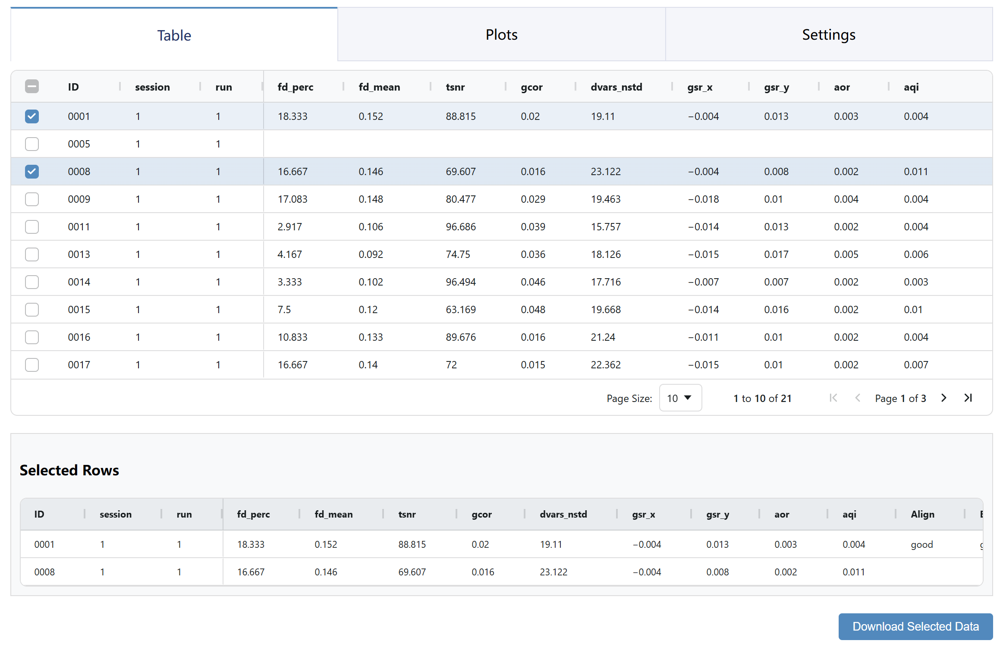
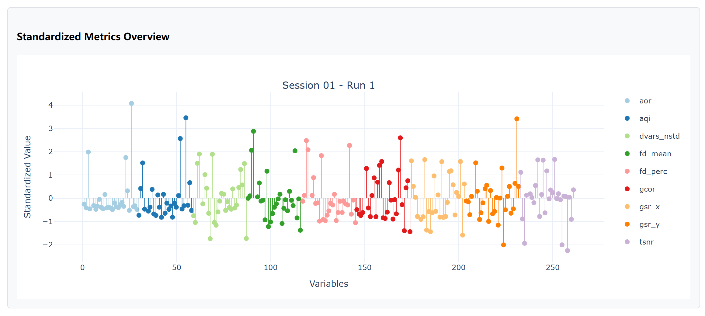

# Dashboard

```bash
fmriqc dashboard afni \
    --data-file /PATH/QC/df_final.csv \
    --task rest

fmriqc dashboard fmriprep \
    --data-file /PATH/QC/df_final.csv \
    --task rest
```

`--data-file`
: The `df_final.csv` written by `fmriqc prep`.

`--task`
: The task name, used in the name of downloaded files.

`--config`
: Optional. The file that holds your settings (see [Config file](config.md#where-the-settings-are-kept)).

Open the link printed in the terminal (see [Opening the pages](opening-pages.md)). The dashboard has filters on the left and three tabs: **Table**, **Plots** and **Settings**.

## Ratings of the metrics

Each metric with thresholds rates every run **good**, **other** or **bad**, or **NA** when the value is missing. Other means "look again". The [Default thresholds](thresholds.md) page lists the thresholds, and the [Settings tab](settings.md) changes them.

When the dashboard opens, runs rated bad on any metric are hidden. Runs rated other are shown, in yellow in the heatmap.

## Filters

```{image} images/sidebar.png
:alt: The filters: the thresholds in force, a rated metric and an unrated one
:width: 280px
```

The top of the sidebar lists the thresholds. Below it, each metric has:

- **a slider**, which keeps only the runs within its range. The green and red numbers above it are the good and bad thresholds.
- **tick boxes** for the ratings to show. Bad starts unticked; tick it to show those runs again.

At the bottom, a list for each section of the report keeps only the runs with the ratings you choose. A run is shown only if it passes every filter.

## Table



The table shows the runs that pass the filters. Click a column name to sort by it, and use **Rows per page** to see more rows at once.

Tick the box at the start of a row to select it, or use **Select All (filtered)** and **Clear**. The selected rows appear under **Selected Rows**, and **Download Selected Data** saves them as `<task>_MRI_QC_subj.csv`, with every column of `df_final.csv`.

## Plots

```{image} images/heatmaps.png
:alt: The heatmaps of the Plots tab
:width: 600px
```

The heatmaps show one column per run: green for good, yellow for other, red for bad and gray for NA. **Quantitative Metrics** has one row per metric with thresholds, and **Qualitative Ratings** one row per section of the report. Hover over a cell to see the run and the metric. The heatmaps follow the filters.

For AFNI, the fraction of TRs censored gets one row per stimulus class:

```{image} images/afni_heatmaps.png
:alt: The heatmaps of an AFNI task dataset
:width: 620px
```



**Standardized Metrics Overview** puts the main metrics on one scale (z-scores), one color per metric and one lollipop per run, so a run far from 0 stands out from the rest. It always shows every run, whatever the filters.
