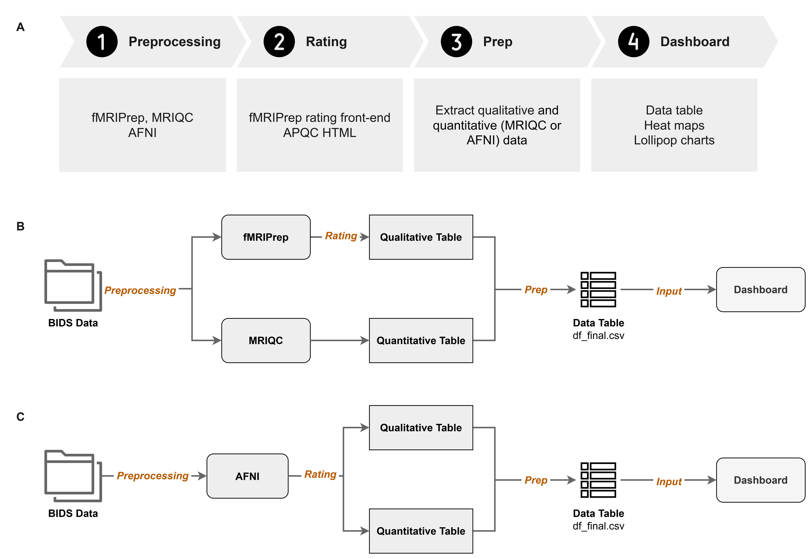

# fMRI-QCtoolkit

fMRI-QCtoolkit helps you check the quality of preprocessed fMRI data across a whole study. It brings together the visual ratings you give each participant's QC report and the quantitative metrics computed by AFNI or MRIQC, and shows both in a dashboard where you filter runs, look at them in a table and in plots, and download the runs you keep.



The toolkit works with two preprocessing pipelines:

- **AFNI** (`afni_proc.py`): you rate the APQC HTML report, and the metrics come from the same QC folder.
- **fMRIPrep**: you rate the fMRIPrep HTML report in the toolkit's rating page, and the metrics come from MRIQC's `group_bold.tsv`.

Each step is one command:

1. **Rate** (`fmriqc rating`): open each participant's QC report and rate its sections good, bad or other.
2. **Prepare** (`fmriqc prep`): collect the ratings and the metrics into one table, `df_final.csv`.
3. **View** (`fmriqc dashboard`): filter and explore `df_final.csv` in the browser, and download the runs you select.

New to the toolkit? Start with [Installation](installation.md) and the [Quick start](quickstart.md). If you work on an HPC cluster, read [Opening the pages](opening-pages.md) as well.

```{toctree}
:caption: Getting started
:hidden:
:maxdepth: 2

installation
quickstart
opening-pages
```

```{toctree}
:caption: Rating
:hidden:
:maxdepth: 2

rating-afni
rating-fmriprep
```

```{toctree}
:caption: Data preparation
:hidden:
:maxdepth: 2

prep
```

```{toctree}
:caption: Dashboard
:hidden:
:maxdepth: 2

dashboard
settings
config
thresholds
```

```{toctree}
:caption: Reference
:hidden:
:maxdepth: 1

cli
troubleshooting
training
changelog
citation
```
