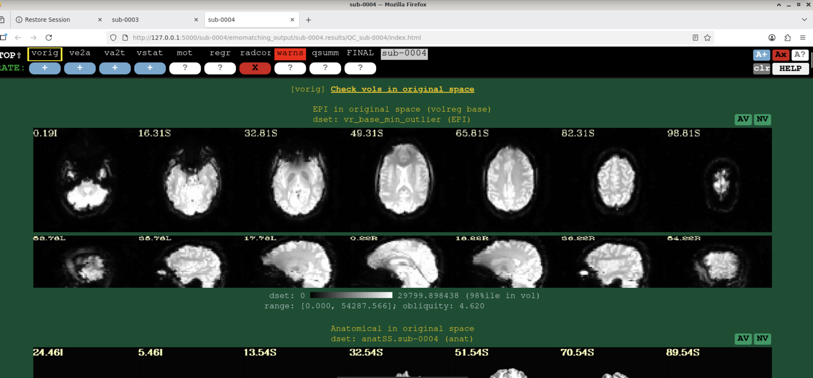

# Rating AFNI output

For AFNI, the rating happens in AFNI's own QC report, the [APQC HTML](https://afni.nimh.nih.gov/pub/dist/doc/htmldoc/tutorials/apqc_html/main_toc.html) that `afni_proc.py` writes for each participant. `fmriqc rating afni` finds the reports of the participants you name and opens them with AFNI's `open_apqc.py`, which adds the rating buttons and saves what you enter.



## Before you start

`open_apqc.py` comes with AFNI and needs the Python packages Flask and Flask-Cors. Either make sure it is on your `PATH` (for example by loading the AFNI module on an HPC cluster), or give the folder that holds it with `--afni-path`.

## Folder layout

`--input-dir` is the folder that holds all participants' AFNI output. The command looks below it for each participant's `QC_<prefix><ID>/index.html`, in a path that contains `--task`. For example:

```
AFNI_derivatives/
├── sub-001/
│   └── ses-01/
│       └── cards_output/
│           └── sub-001.results/
│               ├── QC_sub-001/
│               └── ...
├── sub-002/
└── ...
```

## Command

```bash
fmriqc rating afni --input-dir /PATH/AFNI_derivatives --subjects "001,002" --task ses-01/cards --prefix sub-
```

`--input-dir`
: The folder that holds all participants' AFNI output.

`--subjects`
: The participants to rate, separated by commas or spaces (`"001,002"` or `"001 002"`), or the path of a text file that lists them. A leading `sub-` is ignored.

`--task`
: A part of the path between `--input-dir` and the QC folder, usually the task name (`cards` matches `cards_output`). Add the session (`ses-01/cards`) to pick one session.

`--prefix`
: What comes before the ID in the folder names, usually `sub-`.

`--afni-path`
: Optional. The folder that holds `open_apqc.py`, if it is not on your `PATH`.

Participants without a report are listed in the terminal, and the others open.

## Rating in APQC

The navigation bar at the top of the report names each QC block (`vorig` for the original data, `ve2a` for the EPI to anatomy alignment, `mot` for motion, `qsumm` for the quantitative summary and so on), with a rating button below each name and a `FINAL` button for the overall rating. Click a button to step through good (+), bad (X) and other (?). The `A+`, `Ax` and `A?` buttons fill every empty button at once. Ctrl+click a button (Cmd+click on a Mac) to add a comment. The `SAVING` label is green while ratings are being saved.

APQC saves the ratings and comments in the participant's QC folder. The ratings also go into `QC_<ID>/extra_info/out.ss_review.<ID>.json`, next to the quantitative summary, which is where [`fmriqc prep afni`](prep.md#afni) reads them; the comments stay in the QC folder only. AFNI's [APQC tutorial](https://afni.nimh.nih.gov/pub/dist/doc/htmldoc/tutorials/apqc_html/main_toc.html) describes the report and the buttons in detail.

For what to look at in each block, see the [training materials](training.md).

## If the command cannot find your reports

The command handles the usual `afni_proc.py` layouts, but not every way of arranging the folders. If it does not find your reports, the repository has a [shell script](https://github.com/QiuyuYu3/fMRI-QCtoolkit/blob/main/examples/scripts/rating/afni_rating.sh) that calls `open_apqc.py` directly, which you can adapt to your layout.
