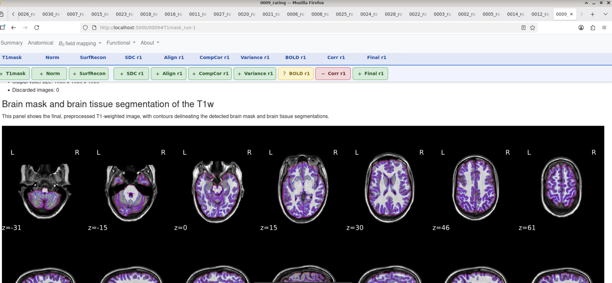

# Rating fMRIPrep output

`fmriqc rating fmriprep` opens each participant's fMRIPrep HTML report (`sub-<ID>.html`) in a page with a rating bar on top. You rate each section of the report, and the ratings are saved as you click.



## Folder layout

`--input-dir` is the fMRIPrep output folder, the one that holds the reports and a folder per participant:

```
fMRIPrep_derivatives/
├── sub-001/
├── sub-001.html
├── sub-002/
├── sub-002.html
├── dataset_description.json
└── ...
```

## Command

```bash
fmriqc rating fmriprep \
    --input-dir /PATH/fMRIPrep_derivatives \
    --subjects "001,002" \
    --output-dir /PATH/ratings
```

`--input-dir`
: The fMRIPrep output folder.

`--subjects`
: The participants to rate, separated by commas or spaces (`"001,002"` or `"001 002"`), or the path of a text file that lists them. A leading `sub-` is ignored.

`--output-dir`
: The folder for the rating files. Use the same folder every time, so that reopening a participant shows the ratings saved before.

`--no-browser`
: Only print the links, without opening browser tabs. Not needed on an HPC cluster's remote desktop (see [Opening the pages](opening-pages.md)).

Participants without a report are listed in the terminal, and the others open. Press Ctrl+C in the terminal when you are done.

## What you rate

The rating bar has one box per section of the report, for each run:

| Box | Section of the fMRIPrep report |
|---|---|
| T1mask | Brain mask and brain tissue segmentation of the T1w |
| Norm | Spatial normalization of the anatomical T1w reference |
| SurfRecon | Surface reconstruction |
| SDC | Susceptibility distortion correction |
| Align | Alignment of functional and anatomical MRI data (coregistration) |
| CompCor | Brain mask and (anatomical/temporal) CompCor ROIs |
| Variance | Variance explained by t/aCompCor components |
| BOLD | BOLD Summary |
| Corr | Correlations among nuisance regressors |
| Final | Your overall rating of the run |

T1mask, Norm and SurfRecon describe the anatomical image, so they are rated once per participant and apply to every run. The other sections are rated per run.

## Using the rating bar

- The upper row lists the sections. Click one to jump to it in the report; scroll the row sideways with the mouse wheel.
- In the lower row, click a box to step through good (+), bad (−) and other (?), and back to unrated.
- Ctrl+click a box (Cmd+click on a Mac) to add or edit a comment.
- Every click is saved at once; there is no save button. When you reopen a participant with the same `--output-dir`, the saved ratings and comments come back.

## Files written

For each participant, `--output-dir` gets:

- `sub-<ID>.json`: the ratings and comments, read back when the page is reopened.
- `sub-<ID>_ses-<session>_<task>.csv`: one file per session and task, with the ratings and comments of each run. This is what [`fmriqc prep fmriprep`](prep.md#fmriprep) reads. Without a session in the report, the name is `sub-<ID>_<task>.csv`, and `fmriqc prep` treats the session as 1.
- `sub-<ID>.csv`: all of the participant's ratings in one row.

## Sessions, runs and multi-session anatomy

The session, task and run of each section come from the report's headings. A run without a run number counts as run 1, matching how `fmriqc prep` reads MRIQC's table.

If a task is split further, for example by acquisition or phase-encoding direction, each part is rated and saved in its own file, but `fmriqc prep` cannot use those files yet and lists them as skipped.

For participants with several sessions, fMRIPrep merges all T1w images into a single anatomical reference ([longitudinal processing](https://fmriprep.org/en/stable/workflows.html#longitudinal-processing)). T1mask, Norm and SurfRecon therefore describe that merged image: one rating per participant, not per session. If several images appear under one of these headings, the participant was processed more than once; check the `Get figure file:` line and rate the one from your current run.
