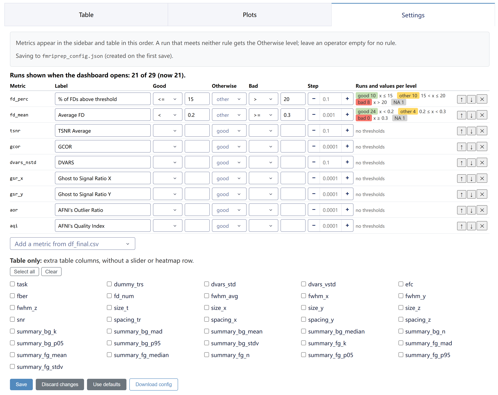

# Settings tab

The **Settings** tab decides which metrics the dashboard shows, in what order and under what names, and the thresholds that rate them. You see the effect of every change before you save it.

## The panel at the top

The gray panel names the file the settings are saved to (see [Where the settings are kept](config.md#where-the-settings-are-kept)). Below it, a line counts the runs that would be shown when the dashboard opens with the settings in the form, and in brackets the number shown with the saved settings.

## One row per metric

Each row is one metric. The rows are the metrics in the sidebar and the table, in this order.

Metric
: The column of `df_final.csv`.

Label
: The name shown in the sidebar, the table header and the heatmap.

Good and Bad
: Each is an operator (`>`, `>=`, `<`, `<=`, `==`, `!=`) and a number. A run that meets the bad rule is bad, and one that meets the good rule is good. Leave the operator empty for no rule. The two rules must not overlap; if a value would meet both, the row says which value and cannot be saved.

Otherwise
: The rating of a run that meets neither rule. Left empty, it follows the rules, and the gray text shows the result: other when there is a good rule, good when there is only a bad rule. Choose good, other or bad to set it yourself.

Step
: The step of the metric's slider. Left empty, it follows the range of the data, and the gray number shows that step.

Runs and values per level
: How many runs each rating gets with the thresholds in the form, and the range of values each rating covers, for example `good 10  x ≤ 15`, `other 10  15 < x ≤ 20`, `bad 8  x > 20`. A metric with no rules shows "no thresholds", and one missing from the data shows "not in the data".

The arrows move a row up or down, and ✕ removes it.

## Ways to use the rules

How many ratings a metric has depends on which rules you fill in:

- **Only Bad**: runs are bad or good. Use it for "exclude above this value".
- **Only Good**: runs are good or other. Nothing is hidden by default; other only marks runs to look at again.
- **Good and Bad with a gap between them**: good, other and bad.
- **Good and Bad that meet**, such as good `< 0.2` and bad `>= 0.2`: good and bad only.
- **Neither**: the metric is shown and can be filtered with its slider, but it is not rated and has no heatmap row. Choosing an Otherwise level without rules gives every run that rating.

## Adding metrics and table columns

**Add a metric from df_final.csv** lists the numeric columns of `df_final.csv` that are not in the form yet. Choose one to add it as a new row at the bottom.

**Table only** lists the remaining columns. A ticked column appears in the table after the metrics, without a slider or a heatmap row. **Select all** and **Clear** tick or untick them all. A column added as a metric leaves this list.

## Saving

Save
: Checks the settings, writes the file, and reloads the page with them. The file it replaces is kept beside it as `<name>.bak`. If the folder cannot be written to, the message says so; use **Download config** and start the dashboard with `--config` next time.

Discard changes
: Goes back to the saved settings.

Use defaults
: Fills in the package's defaults. They are saved only when you press Save.

Download config
: Saves the settings in the form as a file on the computer running the browser, for example to keep with a study, to share, or to start from next time with `--config`. It works even when Save cannot write to the server.

"Unsaved changes" appears next to the buttons until you save. If you saved from another browser tab in the meantime, reload the page before saving here.
